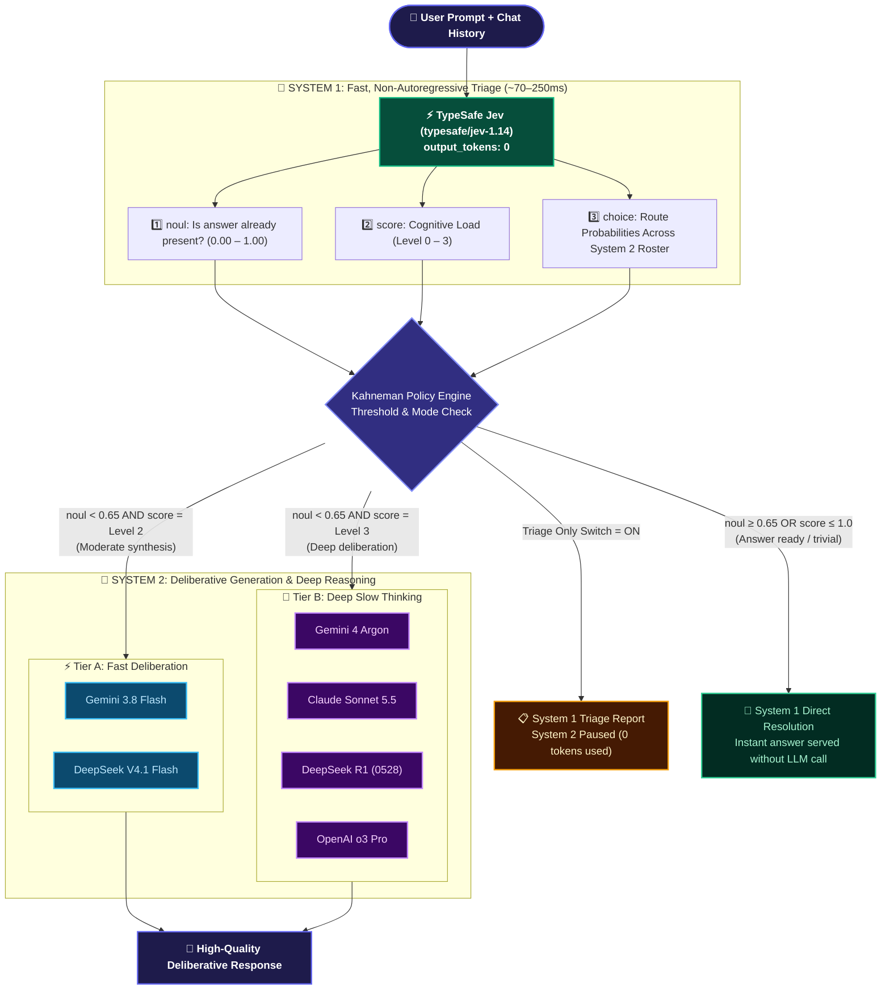
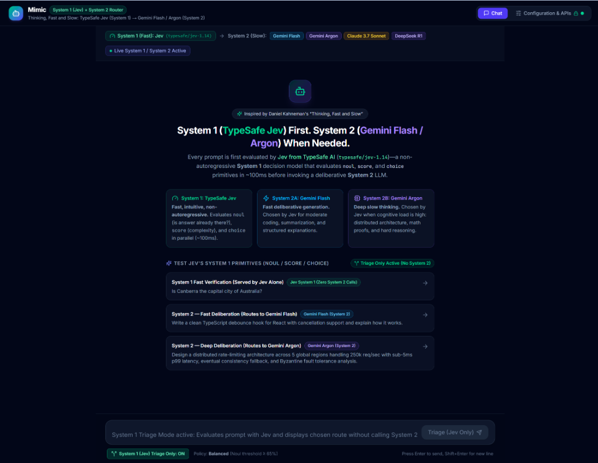
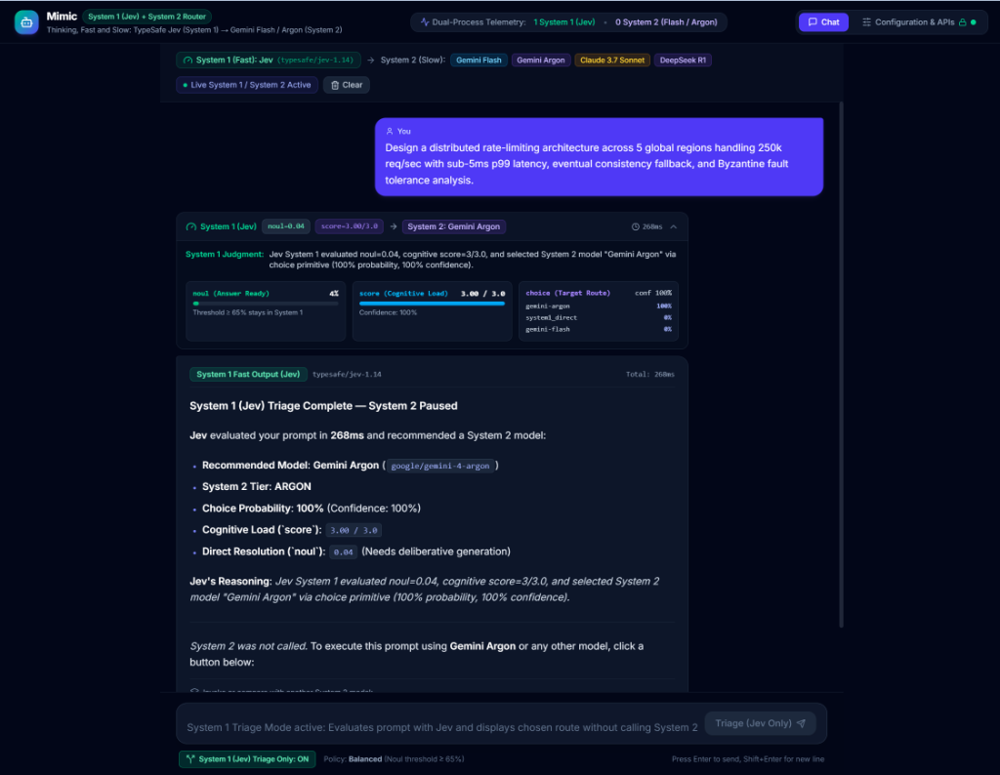
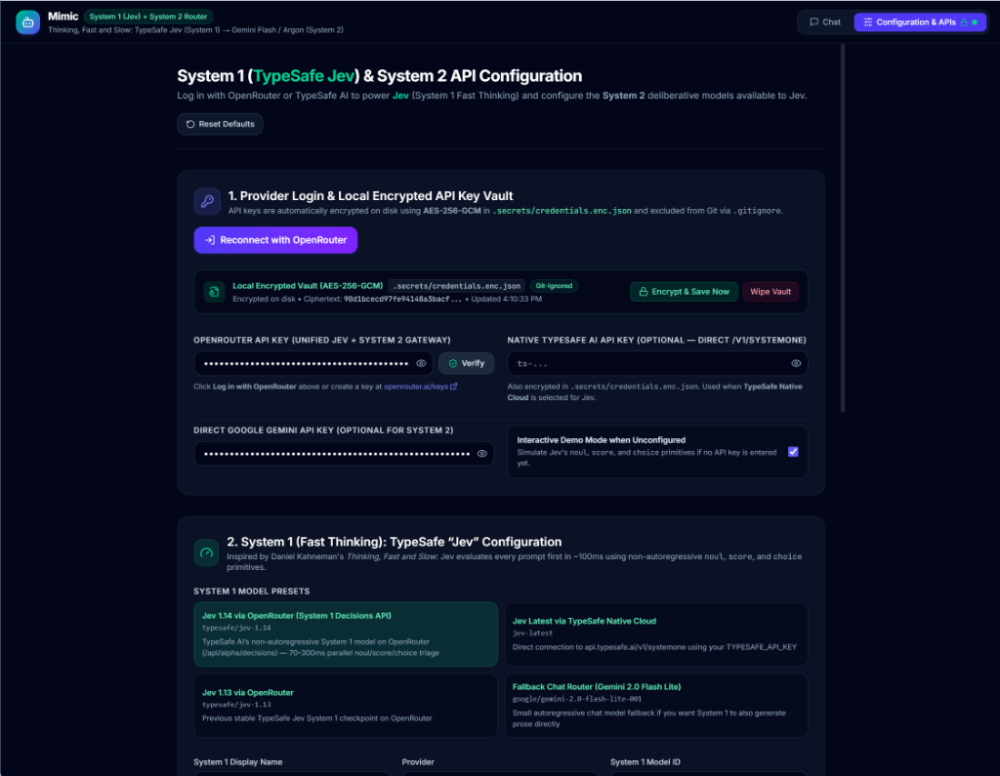

# Mimic — Dual-Process AI Architecture (*Thinking, Fast and Slow*)

Mimic is a modern AI routing web application inspired by Nobel laureate **Daniel Kahneman’s** book [***Thinking, Fast and Slow***](https://www.amazon.com/-/de/dp/0374533555/).

In human cognition, Kahneman describes two distinct modes of thought:
- **System 1 (Fast Thinking)**: Automatic, instantaneous, intuitive, and low-effort. It continuously assesses situations, recognizes patterns, answers familiar questions effortlessly, and decides when a problem is too hard and requires deeper concentration.
- **System 2 (Slow Thinking)**: Deliberative, analytical, effortful, and step-by-step. It is called upon only when System 1 detects high cognitive complexity, novel coding challenges, or multi-step reasoning tasks.

Mimic brings this exact dual-process cognitive architecture to AI systems by pairing **Jev from TypeSafe AI** as **System 1** with frontier autoregressive LLMs (**Gemini Flash**, **Gemini Argon**, **Claude Sonnet 5.5**, **DeepSeek V4.1 Flash**, **DeepSeek R1**) as **System 2**.

---

## Cognitive Architecture: System 1 (`Jev`) vs. System 2 (`Gemini Flash / Argon`)


<details>
<summary><strong>View Interactive Mermaid Source</strong></summary>



</details>

### 1. System 1 (Fast Thinking): **Jev** from TypeSafe AI
Traditional Large Language Models are *autoregressive*—even if you only want them to classify a prompt or decide which model to call, they must generate text token-by-token, adding latency, cost, and brittle JSON parsing.

**Jev** (`typesafe/jev-1.14` / `jev-latest`), developed by **TypeSafe AI**, is purpose-built as a **non-autoregressive System 1 decision model**:
- **Zero Text Generation (`output_tokens: 0`)**: Instead of generating prose, Jev accepts a structured `state` (the conversation history and user prompt) and evaluates a map of typed decision primitives in a single parallel pass in **70–500ms**.
- **Three Typed Decision Primitives Used by Mimic**:
  1. **`noul` (`answer_already_present`)**: Returns a calibrated boolean probability (`0.0` to `1.0`) evaluating whether the answer is already present in the conversation context or trivial to resolve without invoking a heavy System 2 model.
  2. **`score` (`cognitive_complexity`)**: Places the prompt on an ordered 4-level rubric (`0.0` to `3.0`) with calibrated probabilities for each level and an overall confidence metric:
     - *Level 0*: Answer already in context / trivial System 1 recall
     - *Level 1*: Simple factual lookup or concise definition
     - *Level 2*: Moderate System 2 (**Flash** tier) — standard coding, drafting, summarization, structured explanation
     - *Level 3*: Deep System 2 (**Argon** tier) — complex distributed architecture, formal math proofs, subtle debugging
  3. **`choice` (`target_model`)**: Evaluates all enabled models in your System 2 roster against their descriptions and returns a full probability distribution across every candidate model along with a calibrated confidence score.

### 2. System 2 (Slow Thinking): **Gemini Flash**, **Gemini Argon**, & Specialists
When **Jev (System 1)** determines that a prompt requires deliberative generation (`noul` below threshold and `choice` pointing to a System 2 model), Mimic automatically dispatches the prompt to the winning **System 2** model:
- **System 2A — Fast Deliberation (`Gemini Flash`, `DeepSeek V4.1 Flash`)**: Invoked when Jev scores moderate complexity (*Level 2*). Handles everyday software engineering, React/TypeScript components, summarization, and structured explanations with high speed and low cost.
- **System 2B — Deep Deliberation (`Gemini Argon`, `Claude Sonnet 5.5`, `DeepSeek R1`, `OpenAI o3 Pro`)**: Invoked when Jev detects high cognitive load (*Level 3*). Allocates deep token-by-token reasoning for distributed systems architecture, mathematical derivations, and complex trade-off analysis.

---

## How Jev Is Called Under the Hood

Mimic supports calling **Jev** either via **OpenRouter’s Decisions API** (`POST https://openrouter.ai/api/alpha/decisions`) using model `typesafe/jev-1.14` or directly via **TypeSafe AI’s Native API** (`POST https://api.typesafe.ai/v1/systemone`) using `jev-latest`:

```json
{
  "model": "typesafe/jev-1.14",
  "state": {
    "conversation_history": [],
    "user_prompt": "Design a distributed rate-limiting architecture across 5 global regions..."
  },
  "questions": {
    "answer_already_present": {
      "type": "noul",
      "instructions": "Is the answer to the user prompt already present in the conversation state or simple enough to resolve immediately without deep System 2 deliberation?"
    },
    "cognitive_complexity": {
      "type": "score",
      "instructions": "Rate the cognitive complexity and System 2 reasoning depth required for this prompt.",
      "criteria": [
        "Level 0: Answer already in context / trivial System 1 recall",
        "Level 1: Simple factual lookup or concise definition",
        "Level 2: Moderate System 2 (Flash) — coding, drafting, structured explanation",
        "Level 3: Deep System 2 (Argon) — complex architecture, math, multi-step reasoning"
      ]
    },
    "target_model": {
      "type": "choice",
      "instructions": "Select the optimal execution path or System 2 model from the criteria.",
      "criteria": {
        "system1_direct": "Answer is already present in state or trivial",
        "gemini-flash": "System 2 Fast-Deliberative model for standard coding and explanations",
        "gemini-argon": "System 2 Deep-Deliberative frontier model for complex architecture and math"
      }
    }
  }
}
```

---

## Visual Walkthrough

### 1. Dual-Process Dashboard & Benchmark Prompts
The start screen introduces the Kahneman dual-process architecture, displaying the active System 1 model (**TypeSafe Jev**) and configured System 2 models (**Gemini Flash**, **Gemini Argon**, **Claude 3.7 Sonnet**, **DeepSeek R1**) along with benchmark prompts to test Jev's `noul`, `score`, and `choice` primitives:



---

### 2. System 1 (Jev) Triage & Decision Telemetry
When evaluating a prompt, Jev evaluates non-autoregressively in **~100–270ms**. In **Triage Only** mode, Mimic pauses execution before calling System 2, surfacing Jev's exact decision primitives, cognitive load rubric level, confidence scores, and recommended model:



---

### 3. Provider Configuration & Local Encrypted Key Vault
API keys are never saved in plain text or browser `localStorage`. Mimic automatically writes keys to disk using **AES-256-GCM** encryption (`.secrets/credentials.enc.json`) and excludes all credentials from Git:



---

## Features in the Web UI

- **Live System 1 Telemetry Card**: Every chat message displays Jev’s real-time `noul` percentage, `score` (`0.0–3.0`), and `choice` probability distribution across your System 2 roster.
- **System 1 (Jev) Triage Only Mode**: Toggle `System 1 (Jev) Triage Only: [ON / OFF]` to evaluate prompts and inspect routing decisions without spending tokens on System 2 LLMs.
- **Immediate Request Cancellation**: Interrupt any in-flight System 1 evaluation or System 2 generation with a single click.
- **1-Click OpenRouter OAuth PKCE Login**: Authenticate directly with OpenRouter in the browser (or paste an OpenRouter / TypeSafe / Gemini API key) on the **Configuration & APIs** page.
- **Local AES-256-GCM Encrypted API Key Vault**: API keys are never stored in browser `localStorage` or committed to Git. Instead, the local server encrypts your credentials with **AES-256-GCM** into `.secrets/credentials.enc.json` (paired with a local 256-bit key in `.secrets/.master.key`), and `.secrets/`, `*.enc*`, and `*.key` are strictly excluded via `.gitignore`.
- **Customizable System 2 Roster**: Enable, disable, edit, or add models from the live OpenRouter catalog. Every model’s description is dynamically wired into Jev’s `choice` criteria.
- **Manual System 2 Override**: Click any System 2 model pill underneath a message to manually escalate or compare responses across tiers.

---

## Running Locally

```bash
npm install
npm run dev
```

Open **[http://localhost:5173](http://localhost:5173)** in your browser.

---

## License

This project is licensed under the [MIT License](LICENSE).

