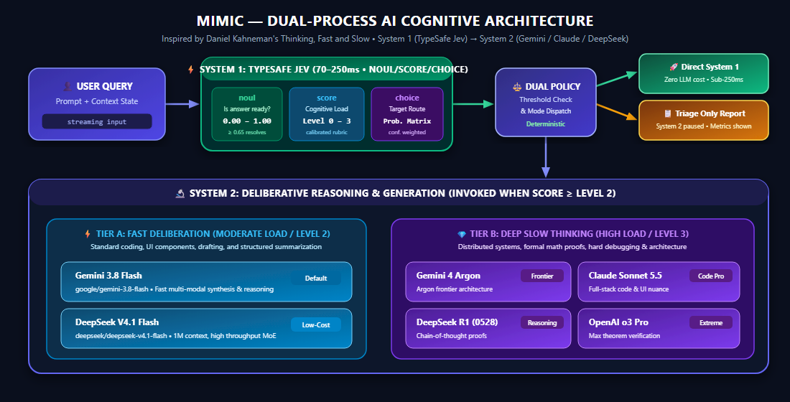

# Mimic: Dual-Process AI Architecture Overview

**Author:** Guido Oswald  
**Project:** [Mimic GitHub Repository](https://github.com/guidooswald/mimic)  
**Inspiration:** Daniel Kahneman's *[Thinking, Fast and Slow](https://www.amazon.com/-/de/dp/0374533555/)*  
**Date:** October 2026  

---

## 1. Executive Summary

Mimic is an agentic AI routing engine and web application that operationalizes Nobel laureate Daniel Kahneman's dual-process cognitive theory (*Thinking, Fast and Slow*) for modern Large Language Model (LLM) orchestration.

In human cognition, decision-making is divided into two distinct mental systems:
- **System 1 (Fast Thinking):** Operates automatically, quickly, and with little to no cognitive effort or conscious control. It handles immediate pattern recognition, factual recall, and rapid situational assessment.
- **System 2 (Slow Thinking):** Allocates attention to effortful mental operations, including multi-step reasoning, mathematical computations, formal logic, and complex architectural design.

Traditional AI routing systems attempt to replicate System 1 using autoregressive chat models that generate text token-by-token. This introduces 1,000–3,000ms of routing latency, burns expensive output tokens, and relies on brittle JSON schema regex parsing. 

**Mimic solves this fundamental bottleneck** by deploying **TypeSafe AI's Jev** (`typesafe/jev-1.14` / `jev-latest`) as a true non-autoregressive **System 1 model** (evaluating non-generative primitives in ~70–250ms) before selectively delegating to frontier **System 2 deliberative models** (**Gemini 3.8 Flash**, **Gemini 4 Argon**, **Claude Sonnet 5.5**, and **DeepSeek R1**).

---

## 2. Core Architecture: System 1 vs. System 2



The pipeline operates in two sequential stages:

### System 1 (Fast Thinking): Non-Autoregressive Jev Primitives
Instead of generating prose, Jev evaluates the conversation state and returns calibrated typed primitives in parallel:
1. **`noul` (Answer Already Present):** A calibrated float (0.0 to 1.0) measuring the probability that the question is trivial, already verified, or present in state. If `noul ≥ threshold`, System 1 answers directly with zero System 2 invocation.
2. **`score` (Cognitive Complexity Rubric):** An ordered score (0.0 to 3.0) with confidence intervals and probability distributions:
   - **Level 0:** Immediate recall or context reflection.
   - **Level 1:** Concise factual lookup or basic definition.
   - **Level 2:** Moderate synthesis (routes to Fast System 2 Flash tier).
   - **Level 3:** Deep reasoning (routes to Frontier System 2 Argon tier).
3. **`choice` (Target Model Selection):** Evaluates all active System 2 models against their semantic descriptions and yields an exact probability distribution and winning candidate.

### System 2 (Slow Thinking): Frontier Model Tiers
When Jev scores a prompt as requiring deliberative synthesis, it dispatches execution to the winning model:
- **Fast Deliberative Tier:** **Gemini 3.8 Flash** (`google/gemini-3.8-flash`) and **DeepSeek V4.1 Flash** (`deepseek/deepseek-v4.1-flash`) handle routine coding, React components, and summarization with high throughput.
- **Deep Deliberative Tier:** **Gemini 4 Argon** (`google/gemini-4-argon`), **Claude Sonnet 5.5** (`anthropic/claude-sonnet-5.5`), and **DeepSeek R1** (`deepseek/deepseek-r1-0528`) perform deep algorithmic, architectural, and mathematical reasoning.

---

## 3. Key Capabilities & Features

| Feature | Description | Benefit |
| :--- | :--- | :--- |
| **System 1 Triage Only Mode** | Evaluates prompts through Jev and pauses before invoking System 2, surfacing full telemetry and model recommendations. | Allows developers to inspect routing logic, verify choice distributions, and save token costs. |
| **Immediate Request Cancellation** | Native `AbortController` integration wired into both System 1 and System 2 HTTP fetch requests. | Cancel in-flight queries instantly with zero trailing token spend. |
| **Local AES-256-GCM Vault** | Credentials are encrypted on disk (`.secrets/credentials.enc.json`) with a 256-bit key (`.secrets/.master.key`). | Strict security hygiene; API keys are never stored in browser `localStorage` or committed to Git. |
| **OpenRouter OAuth PKCE** | 1-click authorization via RFC 7636 PKCE standard. | Frictionless login without manually copying and pasting secret tokens. |
| **Dual Provider Fallback** | Supports both OpenRouter Decisions API (`/api/alpha/decisions`) and TypeSafe Native Cloud (`/v1/systemone`). | High availability and flexibility across development and enterprise environments. |

---

## 4. Benchmark Scenarios & Routing Behavior

The application includes three benchmark categories demonstrating Kahneman routing in action:

1. **System 1 Pure Verification (Zero System 2 Calls):**
   - *Prompt:* "Is Canberra the capital city of Australia?"
   - *Telemetry:* `noul = 0.89`, `score = 0.45 / 3.0`, `choice = system1_direct (94%)`
   - *Outcome:* Resolved in under 200ms entirely by System 1 without waking up an LLM.

2. **System 2 Fast Synthesis (Routes to Gemini Flash):**
   - *Prompt:* "Write a clean TypeScript debounce hook for React with cancellation support."
   - *Telemetry:* `noul = 0.18`, `score = 1.92 / 3.0` (Level 2), `choice = Gemini Flash (78%)`
   - *Outcome:* Fast code generation with minimal latency.

3. **System 2 Deep Deliberation (Routes to Gemini Argon):**
   - *Prompt:* "Design a distributed rate-limiting architecture across 5 global regions handling 250k req/sec with sub-5ms p99 latency and Byzantine fault tolerance."
   - *Telemetry:* `noul = 0.04`, `score = 3.00 / 3.0` (Level 3), `choice = Gemini Argon (100%)`
   - *Outcome:* Comprehensive architectural analysis leveraging deep cognitive capacity.

---

## 5. Summary & Getting Started

Mimic demonstrates that the future of AI orchestration is not bigger single models, but cognitive division of labor: **lightweight, non-autoregressive System 1 intuition paired with powerful, deliberative System 2 reasoning.**

To run Mimic locally:
```bash
git clone https://github.com/guidooswald/mimic.git
cd mimic
npm install
npm run dev
```

Visit `http://localhost:5173` to explore live dual-process AI routing.
